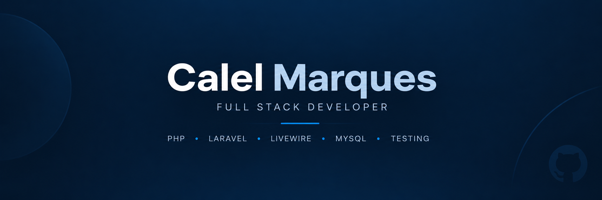
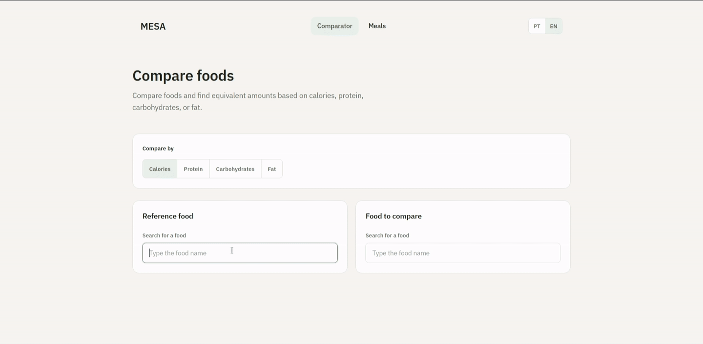

  

## About

Full Stack Developer focused on PHP and Laravel. I build applications with Livewire, MySQL, automated testing, and a focus on maintainable backend architecture.

My main project, MESA, is a production-deployed nutrition application featuring transactional data flows, 300+ automated tests, a reproducible nutritional-data pipeline, and Docker-based deployment with automated CI/CD.

## Tech Stack

  
  
  
  
  
  
  
  
  

## Featured Project

### [MESA](https://github.com/caalel/mesa)

A production-deployed nutrition web application for comparing foods and building meals while tracking calories and macronutrients.

 **[Live Application](https://mesa--web--gpbj9lmc4t6r.code.run)** ·  [Source Code](https://github.com/caalel/mesa)

  

Laravel 13 · Livewire 4 · MySQL · Docker · GitHub Actions CI/CD

300+ automated tests · transactional guest-to-user meal migration · reproducible TACO 4 data pipeline · bilingual interface

## Contact

  
  

